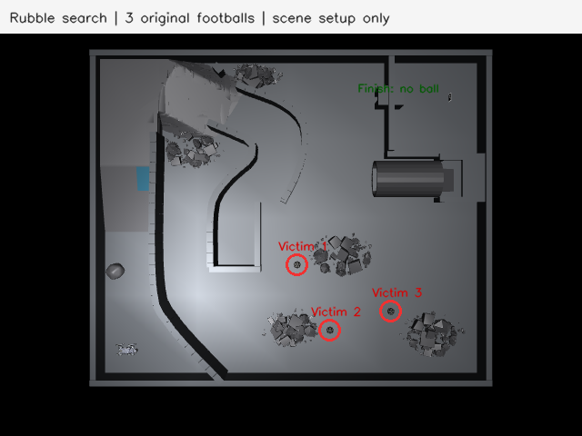

# Go2 废墟搜救仿真与自主导航

基于 Python 的模块化 Go2 搜救原型：雷达定位建图、前沿探索、A* / DWA规划避障、足球伤员识别和终点停车。默认在 **Ubuntu 24.04 / WSL2、Python 3.12** 中运行 MuJoCo 仿真，不依赖 ROS 2、强化学习或预训练步态策略。

**仿真使用开源凸MPC运动控制器；实物后端另行封装宇树SDK2的 `SportClient.Move/StopMove`，尚未执行真机运动验证。** 资源来源与许可见 [NOTICE](NOTICE.md)、[第三方说明](THIRD_PARTY_V1.md)；整个资源包不能统一视为MIT许可。

## 当前任务与实测状态

默认搜索模式在碎石附近放置3个原始足球模型，移除终点足球。机器狗按人工路线通过上下坡、S弯、死胡同和窄出口，再边建图边识别足球；**没有主动原地全景补扫**。估计地图覆盖率达到90%后，沿东侧路线绕过圆管2去终点。覆盖率未达标但时间不足时，允许带未达标标记的保护返航。



最近可复核记录 `run-20261117-173813`：

| 检查项 | 单次实测结果 |
|---|---|
| 起点与场景 | 原始起点、seed0；本地入口坡及多足球派生场景 |
| 覆盖率切换 | 189.4仿真秒达到90.01%，切换去终点 |
| 终点 | 327.702仿真秒完成视觉确认与停车；墙钟774.823秒 |
| 最终地图覆盖率 | 92.75%，基于公开边界内的估计占据地图 |
| 伤员报告 | 匹配3/3个球，另有1次误报、1次重复报告 |
| 物理诊断 | 未跌倒；采样诊断障碍接触、进水、越界均0 |
| 严格任务判定 | `local_task_pass=false`，误报问题仍未解决 |

[摘要、配置与场景来源](docs/validation/mapping-search-20261117/validation.json) 已随仓库保留。独立诊断每10毫秒采样，不是逐2毫秒物理步审计。**这是一次本地场景结果，不是多起点/噪声成功率，也不是官方比赛成绩。** `mission_complete=true` 表示终点停车，不代表所有伤员报告均正确。

## 安装（WSL / Ubuntu 24.04）

在Windows中安装Ubuntu 24.04的WSL环境，确保WSLg可以显示窗口。以下命令在WSL终端运行。必须完整克隆仓库，包含 `scene/`、`robot/` 和 `third_party/`；虚拟环境不能从其他机器直接复制。

```bash
git clone https://github.com/dyyyds13/unitree_map_nav.git
cd unitree_map_nav
sudo apt update
sudo apt install -y python3.12-venv libgl1 libegl1 libglfw3 libgl1-mesa-dri
python3.12 -m venv .venv
.venv/bin/python -m pip install -r requirements-v1.lock.txt
.venv/bin/python -m pip install -e . --no-deps
.venv/bin/python -m pip check
```

锁文件包含仿真、测试和可选KISS-ICP依赖，不包含宇树真机SDK。已用Python3.12.3验证；MuJoCo固定3.17.0，主要依赖为NumPy1.26.4、SciPy1.13.1、CasADi3.6.7、OSQP1.1.3、OpenCV contrib headless4.10.0.84。详见 [Python环境](docs/PYTHON312.md)。

开发目录可以放在Linux文件系统（例如 `~/projects/`）。仓库带有位置无关的启动脚本，不依赖原电脑的盘符、用户名或虚拟环境链接。

## 启动仿真

在仓库根目录运行：

```bash
bash start-simulation.sh
```

默认启用窗口、前视相机、15Hz窗口刷新、快速渲染和1200仿真秒预算。WSLg环境下脚本选择D3D12并保留已有环境变量覆盖；其他Linux环境沿用本机OpenGL配置。GPU用于窗口和相机渲染，物理、建图、规划、识别和MPC仍在CPU运行。

```bash
# 较短时限会相应提前触发时间预留保护
bash start-simulation.sh --seconds 600

# 无查看窗口；WSL仍需要WSLg/GLFW进行相机渲染
GO2_HEADLESS=1 bash start-simulation.sh --seconds 600

# 旧有序路线模式，仍带管道出口下降保护
bash start-simulation.sh --task-layout finish-area --course-policy ordered --seconds 260
```

参数可追加到脚本后；脚本切换到仓库目录并调用 `.venv/bin/go2-rescue mujoco`。默认保留停止时的最终窗口，关闭窗口退出；追加 `--close-viewer-on-stop` 可自动关闭。中途关闭窗口或Ctrl+C会结束运行。`--seconds` 范围 `(0,1200]`，是仿真时间，不是现实等待时间。

`--fast-render` 关闭窗口、相机和视频中的阴影/反射，会改变感知图像，对比实验需保持设置一致。直接调用CLI时也可选择 `MUJOCO_GL`、`GALLIUM_DRIVER` 等环境变量。

```bash
.venv/bin/go2-rescue mujoco --help
```

输出在 `output/run-时间戳/`：包含运行日志、轨迹、`summary.json`、配置与场景来源。默认不录屏，不保存原始传感器或物理归档；额外记录需显式启用 `--record`、`--video`、`--save-physics` 或 `--snapshots`。运行输出不提交Git。

## 模块与修改入口

```text
雷达/IMU/相机/关节状态 → Frame
  → 定位ICP与回环 → 地面/障碍/净空地图
  → 人工阶段路线或前沿探索 → A*路径 → DWA安全速度
  → Velocity(vx,vy,wz) → 凸MPC/步态 → 12关节力矩 → MuJoCo
相机 → 圆弧/纹理足球检测 → 几何定位/多帧跟踪 → 本地target事件
相机 → 实验ArUco终点 → 对齐/停稳确认 → 本地finish事件
```

| 修改目标 | 文件 |
|---|---|
| 任务调度 | [controller.py](src/go2_rescue/controller.py) |
| ICP定位、关键帧、回环 | [localization.py](src/go2_rescue/localization.py) |
| 地图、支撑、坡度、净空 | [mapping.py](src/go2_rescue/mapping.py)、[terrain.py](src/go2_rescue/terrain.py) |
| 前沿选择、A*、DWA、脱困 | [planning.py](src/go2_rescue/planning.py) |
| 覆盖率任务、返航、终点条件 | [search.py](src/go2_rescue/search.py) |
| 足球检测、定位、去重 | [perception.py](src/go2_rescue/perception.py)、[tracking.py](src/go2_rescue/tracking.py) |
| 仿真MPC适配与开源控制器 | [mpc_locomotion.py](src/go2_rescue/mpc_locomotion.py)、[third_party/go2_convex_mpc](third_party/go2_convex_mpc) |
| 宇树实物SDK封装 | [motion.py](src/go2_rescue/motion.py) |
| 仿真与独立评估 | [mujoco_sim.py](src/go2_rescue/mujoco_sim.py)、[evaluation.py](src/go2_rescue/evaluation.py) |
| 足球布置，不输入导航 | [rubble-search-layout.json](configs/rubble-search-layout.json) |
| 覆盖率阈值、公开边界、终点接近点 | [search-route.json](configs/search-route.json) |
| 前半程人工路线及参数 | [local-entry-ramp-route.json](configs/local-entry-ramp-route.json) |

`search-route.json` 的 `coverage_threshold=0.90`；`exploration_bounds` 使用起点相对地图坐标。覆盖率统计公开12×10米边界内已分类自由/障碍栅格，**不等于可行走面积、相机查看比例或伤员召回率**。暂时无可达前沿时等待地图更新，不宣称探索完成。

前半程及终点接近仍使用人工地图先验，尚非完全未知场地从零导航。导航不读取真实机器人位置或足球布置坐标。路线/布置PNG仅作说明，不参与控制。详见 [架构](docs/ARCHITECTURE.md)、[搜索任务](docs/SEARCH_MISSION.md)。

## 场景与已知限制

- 原资源保持校验一致；`--task-fixture` 生成本地派生场景，默认把圆管2东侧坡移到西侧入口。`--pipe-ramp official` 保留原坡位置。新搜索允许绕管道，旧有序模式保留下降保护。
- MuJoCo显示官方物理碰撞几何，GLB提供更详细的砖墙/PBR外观。原资源说明见 [scene/README.md](scene/README.md)。
- 足球使用传统圆弧/黑白纹理检测，仍有碎石误报和重复报告风险，没有使用深度学习检测器。
- 终点采用实验ArUco42；**官方伤员报位、世界坐标对齐和任务终止通信未接入**。`target`/`finish` 只是本地事件。
- 导航与物理/显示同步运行。后期回环、历史地图重建和规划会产生耗时尖峰；GPU渲染不能消除CPU卡顿。见 [性能记录](docs/PERFORMANCE.md)。
- 实物型号、驱动和标定未确认，默认 `calibrated=false`；仿真成功不能代替真机验证。

## 测试与仓库检查

```bash
# WSL使用GLFW；其他平台按实际渲染环境选择
MUJOCO_GL=glfw .venv/bin/python -m pytest -q
.venv/bin/python -m pip check
.venv/bin/python scripts/check_repository.py
git diff --check
```

仓库检查脚本只读文件：核验原始SHA256、待发布文件大小、生成文件混入及有限的凭据模式，不进行提交或推送，也不代表完整历史安全审计。测试和发布准备结果见 [发布前清单](docs/RELEASE_PREPARATION.md)。

新仓库发布方式见同一清单。保留来源与许可证；新增远程前核对仓库所有者，避免推送到原上游。
